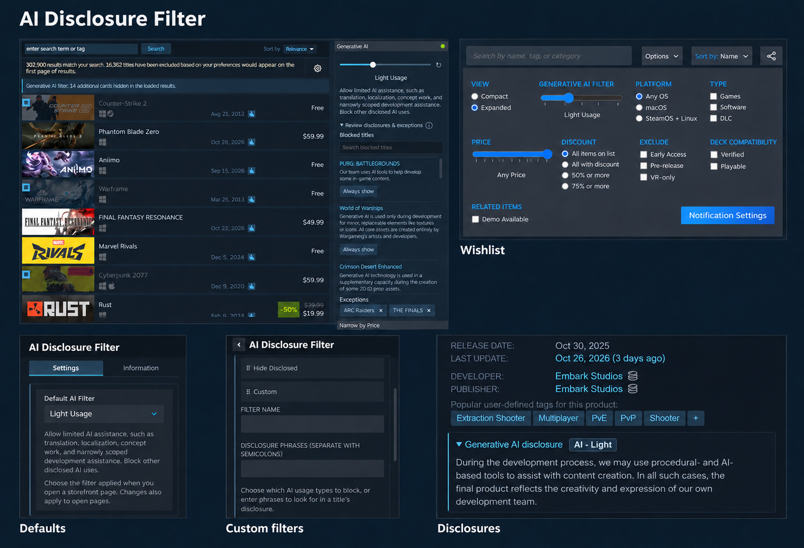
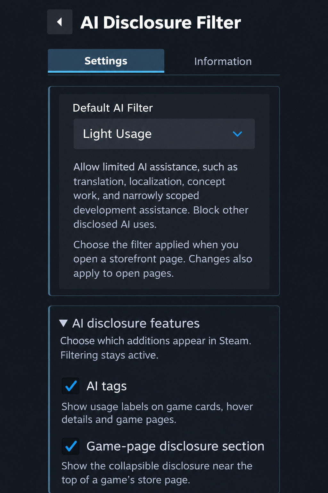
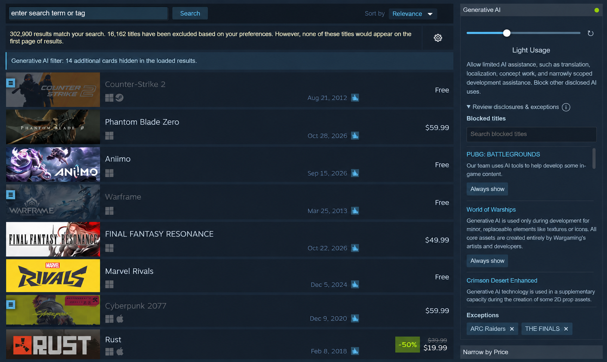
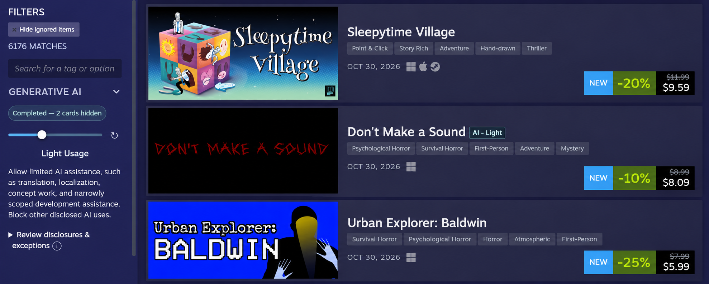
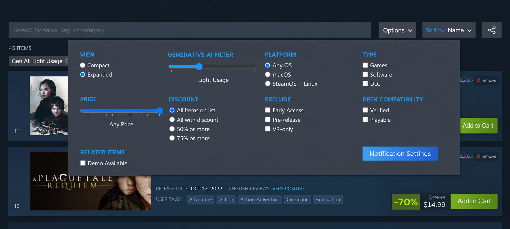
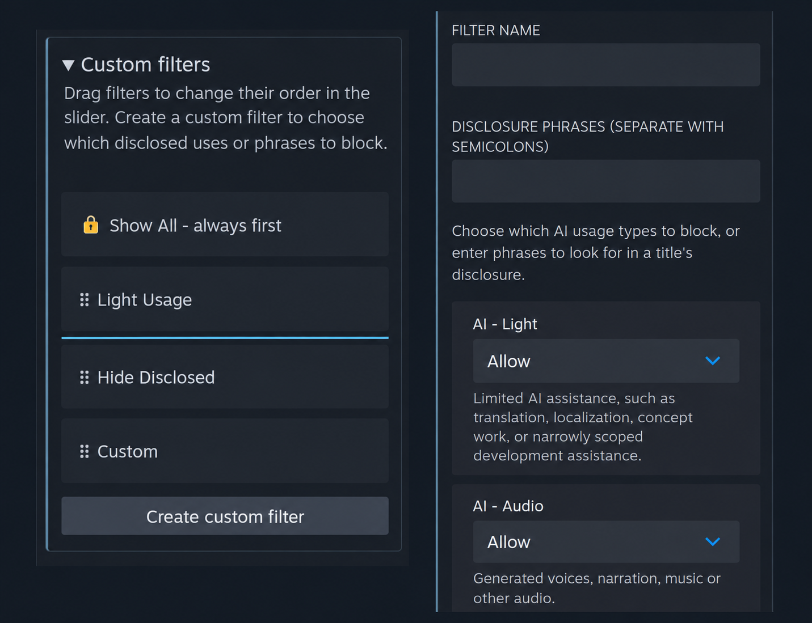
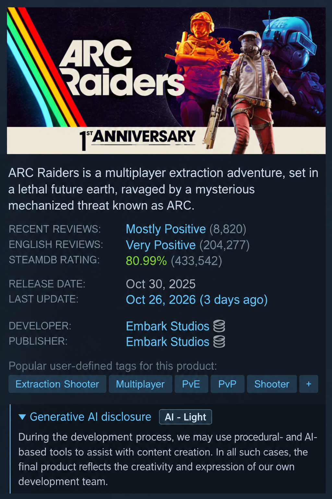

# AI Disclosure Filter

A Millennium plugin that lets you filter games with Steam AI disclosures and see how they use generative AI while browsing the store.

> **AI Disclosure**
>
> I built this plugin with ChatGPT Codex, then manually revised and tested it. Before publishing, I reviewed the full codebase and made changes where needed. I have a programming background, understand the code, and can maintain and debug it without AI assistance.

## Features

- Filter games in search results, categories, sale pages and your Wishlist.
- See AI usage tags on game cards and hover popups, and read the full disclosure near the top of a game's page.
- Set different defaults for store listings and discovery feeds. Choose whether wishlisted or owned games should stay visible.
- Create custom filters for AI usage types or phrases you want to block, and drag filters into your preferred order.
- Keep individual games visible with saved exemptions, managed from the filter sidebar or plugin settings.

## Installation

1. Install [Millennium](https://steambrew.app/) for the Steam desktop client.
2. Download the `.star` file from the [latest GitHub release](https://github.com/ZaneDragonBorn/steam-ai-disclosure-filter/releases/latest).
3. Fully exit Steam and copy the file into Millennium's plugins directory:

    | Platform | Plugins directory                    |
    | -------- | ------------------------------------ |
    | Windows  | `<Steam folder>/millennium/plugins/` |
    | Linux    | `~/.local/share/millennium/plugins/` |

4. Start Steam and enable **AI Disclosure Filter** under **Steam → Millennium → Plugins**. Save your changes and restart if prompted.

Download the `.star` file rather than the source-code ZIP. Once the plugin is approved, you'll also be able to install it through SteamBrew. For help installing Millennium, see its [user guide](https://docs.steambrew.app/users/).

## Usage

### 1. Set your defaults

1. Open **Steam → Millennium Library Manager → AI Disclosure Filter**.
2. Choose the **Default AI Filter** you want to use when opening store listings.
3. Expand **Discovery AI Filter** to choose a filter for recommendations and discovery feeds. You can also keep wishlisted or owned games visible here.
4. Under **AI disclosure features**, choose whether to show AI tags and the disclosure on game pages. Filtering still works with these turned off.

### 2. Filter a store listing

1. Open [Steam search](https://store.steampowered.com/search/), a category or a sale page with game filters.
2. Choose a preset with the **Generative AI** slider. It applies automatically, including to games loaded as you scroll.
3. Open **Review disclosures & exceptions** to see what's been blocked. Choose **Always show** to keep a game visible.

| Preset             | What it does                                                                                |
| ------------------ | ------------------------------------------------------------------------------------------- |
| **Show All**       | Keep every game visible.                                                                    |
| **Light Usage**    | Allow limited assistance, such as localization or concept work; block other disclosed uses. |
| **Custom**         | Block disclosures containing your chosen phrases.                                           |
| **Hide Disclosed** | Block all games with an official AI disclosure.                                             |

Exempted games stay visible with any preset. If a newly saved custom filter is missing, click the refresh icon beside the slider.

_Search results:_

_Category listings:_

### 3. Filter your Wishlist

1. Open your Wishlist and choose **Options → Generative AI Filter**.
2. Choose a preset on the slider. To clear it, remove the **Gen AI: …** tag above your Wishlist.

### 4. Customize filters and exemptions

1. In plugin settings, expand **Custom filters**. Give your filter a name and choose which AI usage types or disclosure phrases to block.
2. Save it to use it in the filter sliders. Drag filters into the order you want them to appear.
3. Expand **Exemptions** to add a game by Steam App ID, review its saved disclosure or remove an exemption.

### 5. Read a game's disclosure

AI tags give you a quick idea of a game's disclosed usage. To read Steam's full disclosure, open the game's store page and expand **Generative AI disclosure** near the top.

## Known Limitations

Some games in discovery feeds may remain visible even when your filter would normally hide them. Some Steam filter menus may also be missing the Generative AI control. Steam uses different layouts across the store, and not all of them are covered yet.

If you find either of these, please [let me know](https://github.com/ZaneDragonBorn/steam-ai-disclosure-filter/issues) so I can look into adding support.

The plugin relies on Steam's disclosures. If it can't confirm a disclosure, the game stays visible.

## Reporting Issues

Found something that isn't working? [Open an issue on GitHub](https://github.com/ZaneDragonBorn/steam-ai-disclosure-filter/issues).

Include the page link, the filter you were using and what happened. A screenshot and steps to reproduce it are helpful too.

## License

Created and maintained by **Zane Dragonborn**. Licensed under [MIT](LICENSE). See [third-party notices](THIRD_PARTY_NOTICES.md) for upstream acknowledgments.
